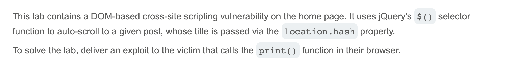
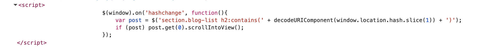
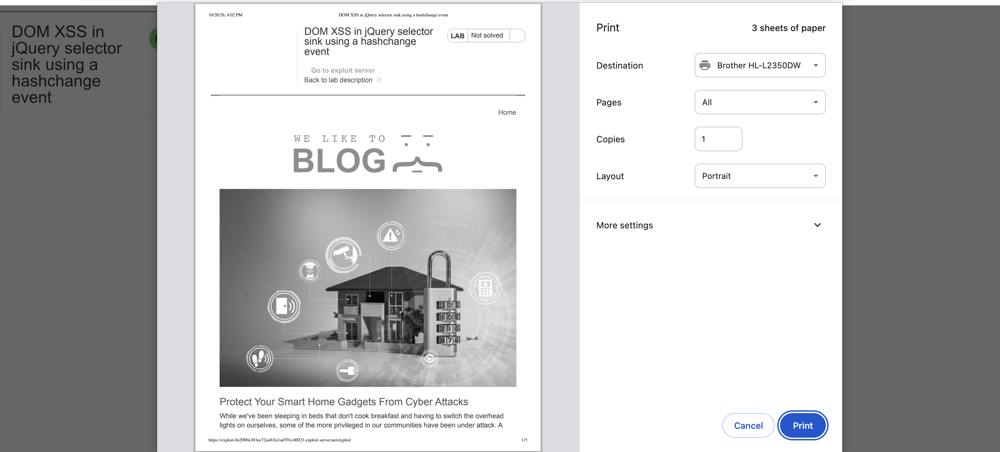

# Write-up: DOM XSS in jQuery selector sink using a hashchange event @ PortSwigger Academy

Lab-Link: <https://portswigger.net/web-security/cross-site-scripting/dom-based/lab-jquery-selector-hash-change-event>  
Difficulty: APPRENTICE

## Exploitation
I started by opening the Inspect panel on the home page and looking for the `hashchange` event. I found the following code showing that, upon event trigger, the hash from the URL is used directly within the program:

This would be a good entry point for my malicious code, but I first needed to figure out how to trigger a `hashchange` event. I landed on `<iframe src="https://id.web-security-academy.net/#" onload="this.src+=''">`. The iframe loaded the vulnerable website with an empty hash, then appended my payload to the URL. This triggered the hashchange event, causing a reload of the iframe, an error when trying to load a nonexistent image, and, consequently, the running of the desired function. When testing the exploit on myself, I was greeted with a print preview, indicating success:

