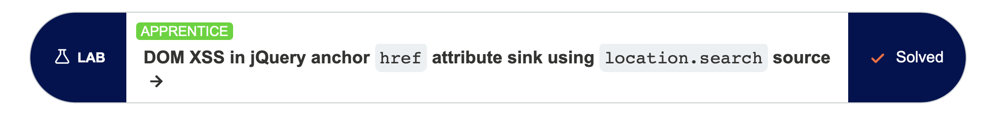
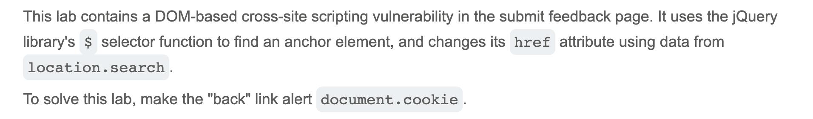
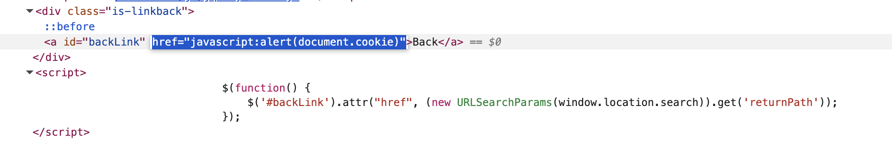
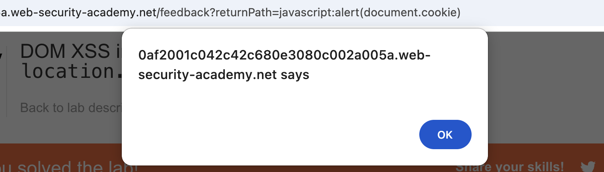

# Write-up: DOM XSS in jQuery anchor href attribute sink using location.search source @ PortSwigger Academy

Lab-Link: <https://portswigger.net/web-security/cross-site-scripting/dom-based/lab-jquery-href-attribute-sink>  
Difficulty: APPRENTICE

## Exploitation
I first headed to the "Submit Feedback" page as this was where the vulnerability lived. I opened the Inspect panel and learned that the "back" link is directly taken from the URL. Noting this as a source, I modified the end of the URL to `?returnPath=javascript:alert(document.cookie)` to the end of the URL. This resulted in the following code:

I then pressed the "Back" button, at which point I was met with an alert and a success banner:

