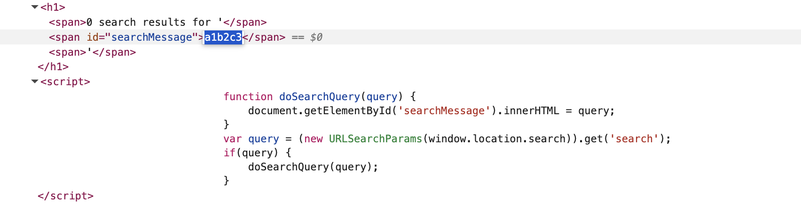
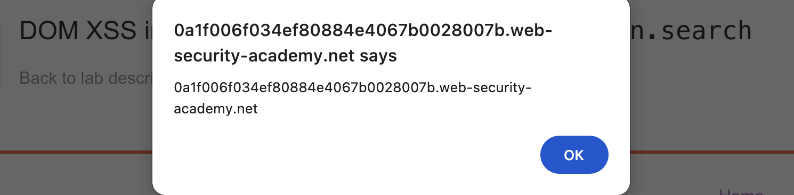

# Write-up: DOM XSS in innerHTML sink using source location.search @ PortSwigger Academy

Lab-Link: <https://portswigger.net/web-security/cross-site-scripting/dom-based/lab-innerhtml-sink>  
Difficulty: APPRENTICE

## Exploitation
I started by searching the unique string `a1b2c3` in the website's search bar containing the vulnerability. Next, I opened the Inspect panel in my browser and searched for my string to locate its presence throughout the DOM. I found that an element's `innerHTML` was being set to the value of my string:

This would allow me to insert a malicious payload. However, `innerHTML` does not run certain elements that one may typically use here, like `script` and `svg onload`, so I had to try something else. I searched `` and the browser displayed an alert, indicating a successful attack:

