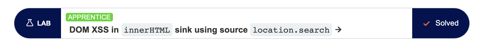
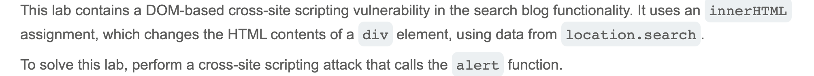
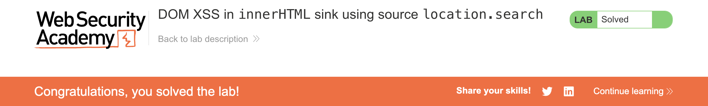

# Write-up: [Lab Title] @ PortSwigger Academy

Lab-Link: <https://portswigger.net/web-security>  
Difficulty: [APPRENTICE]

## Exploitation
I was told there was an XSS vulnerability in the search functionality, so I inserted a script in hopes that my text is directly echoed and run: 

`code`

Upon return, I received a success message:

