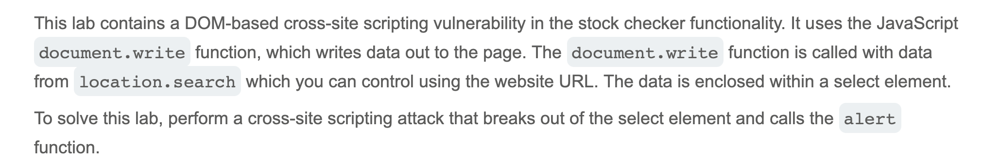

# Write-up: DOM XSS in document.write sink using source location.search inside a select element @ PortSwigger Academy


Lab-Link: <https://portswigger.net/web-security>  
Difficulty: [PRACTITIONER]



## Exploitation
I was told there was an XSS vulnerability in the stock checker functionality, so I started by clicking the "Check stock" button for the London store and intercepting the request. In the request, I spotted the string `productId=1&storeId=London`; the site URL only contained the `productId`, so learning about the `storeId` was helpful because this variable was important in knowing which stock to check. 

Next, I used the Inspect panel in my browser and searched for "London" to see how this input was being used. I came across the following code: 

```js
var stores = ["London","Paris","Milan"];
var store = (new URLSearchParams(window.location.search)).get('storeId');
document.write('<select name="storeId">');
```

The `storeId` value was inside a select element, so I started crafting a string that could break out of this element and run `alert()`. I ended up inserting `">');<svg onload=alert()>`, making the end of the URL `productId=1&storeId=">');<svg onload=alert()>`. This resulted in:


The browser displayed an alert, indicating success:


