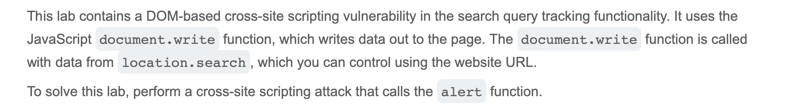
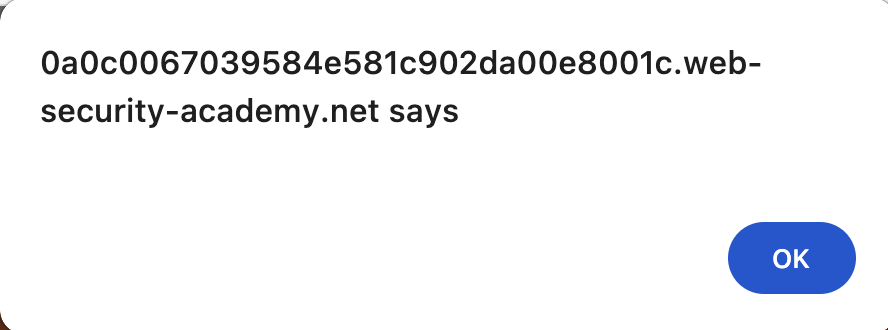

# Write-up: DOM XSS in document.write sink using source location.search @ PortSwigger Academy

Lab-Link: <https://portswigger.net/web-security/cross-site-scripting/dom-based/lab-document-write-sink>  
Difficulty: APPRENTICE

## Exploitation
I started by searching the unique string `a1b2c3` in the website's search bar containing the vulnerability. Next, I opened the Inspect panel in my browser and searched for my string to locate its presence throughout the DOM. I found my string inside an image tag: ``. I crafted a string that would allow me to break out of the `img` tag and run the alert function. I came up with `"><svg onload=alert()>` which resulted in:

The browser displayed an alert, indicating success:

