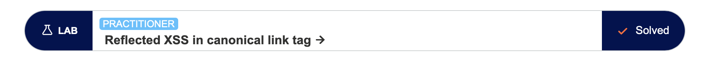
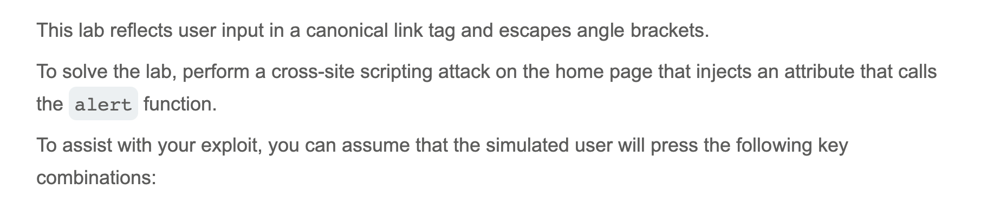
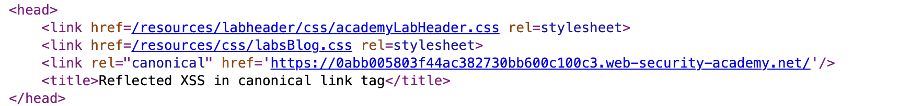
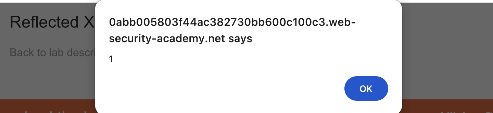
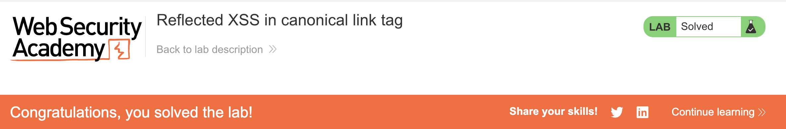

# Write-up: Reflected XSS in canonical link tag @ PortSwigger Academy

Lab-Link: <https://portswigger.net/web-security>  
Difficulty: PRACTITIONER

## Exploitation

I started by viewing the homepage's raw HTML via Page Source and saw that its URL was inside an `href` tag:

This was a possible opening to inject attributes to the tag and run my exploit, so I started crafting a payload. I ended up with `?'accesskey='x'onclick='alert(1)'`, which appended to the end of the URL as `web-security-academy.net/?%27accesskey=%27x%27onclick=%27alert(1)%27`. I pressed `CTRL+ALT+X` and saw the alert:

