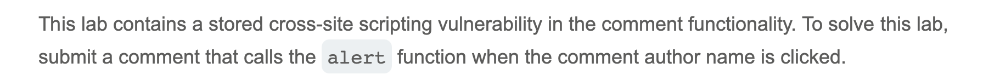
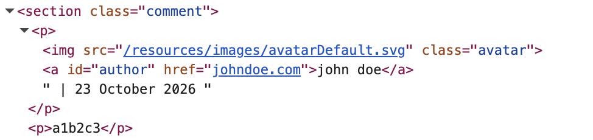
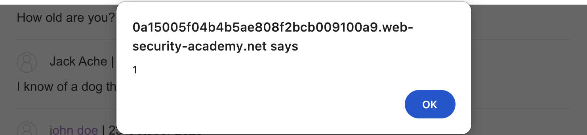

# Write-up: Stored XSS into anchor href attribute with double quotes HTML-encoded @ PortSwigger Academy

Lab-Link: <https://portswigger.net/web-security/cross-site-scripting/contexts/lab-href-attribute-double-quotes-html-encoded>  
Difficulty: APPRENTICE

## Exploitation
I started by clicking on a post and commenting the unique string `a1b2c3`. I returned to the post, opened the Inspect panel, and searched for my string. I saw that the "Website" field I filled in when commenting was being stored in an href, giving me a possible opening to attack:

I drafted another comment, this time putting `javascript:alert(document.domain)` in the "Website" field. I returned to the post and clicked my user's name, after which I received an alert:

